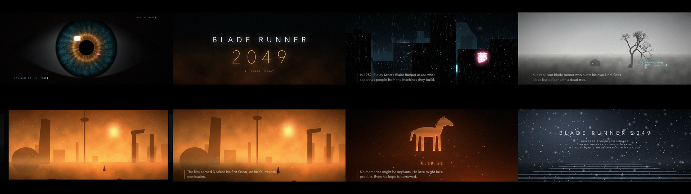

# Blade Runner 2049 — A Video Essay

一支 90 秒的《银翼杀手 2049》动态图形视频随笔，**每一帧都由代码生成**（numpy + Pillow），配乐和音效也是用 numpy 合成的原创作品。没有使用任何电影片段、剧照或演员肖像。

A 90-second motion-graphics video essay about *Blade Runner 2049*. Every frame is generated procedurally with numpy + Pillow, and the score is an original numpy synth. It uses no film footage, stills or actor likenesses.



**▶ 成片下载 / Watch:** see the [latest release](../../releases/latest) (1080p · 24 fps · 2.39:1 letterbox · 90 s).

## 结构 / Structure

| Time | Scene |
|---|---|
| 0–9s | 眼睛特写 + LA 2049 的 HUD，镜头推进瞳孔 / Eye close-up and HUD, pushing into the pupil |
| 9–17s | 霓虹逐字点亮的标题 / Neon title ignition and lens flare |
| 17–32s | **I · Thirty Years Later**：雨夜洛杉矶、韩日中文霓虹、飞行车 / Rainy neon LA, flying cars |
| 32–46s | **II · The Miracle**：灰色农场、枯树、地下扫描 HUD / Grey farm, dead tree, subsurface scan |
| 46–64s | **III · A World in Four Colors**：四色板展开成橙色拉斯维加斯 / Palette board opening into orange Las Vegas |
| 64–78s | **IV · More Human**：木马记忆 6.10.21、故障效果、全息粉青色调 / Wooden-horse memory, glitches, hologram grade |
| 78–90s | 雪中台阶 + 片尾字幕 / Snow on the steps and end credits |

## 构建 / Build

Requirements: macOS (it uses system fonts: Avenir Next, Menlo, Apple SD Gothic Neo and Hiragino Sans GB), Python 3.9+, `numpy`, `Pillow`, and `imageio-ffmpeg` (or `ffmpeg` on your `PATH`).

```bash
pip3 install numpy pillow imageio-ffmpeg
./build.sh /tmp/br2049-build blade_runner_2049_essay.mp4
```

The build renders video with 8 parallel workers (`JOBS=8` by default) while synthesising the score, then muxes the two. It takes about 8 minutes on an 8-core Apple Silicon Mac.

Preview individual frames without a full render:

```bash
python3 render.py still 5,12.5,24,40.5,60,68,85 /tmp/br2049-stills
```

| File | What it does |
|---|---|
| `render.py` | The timeline, the 7 scenes, text cards, HUD, film finishing (bloom, grain, vignette, letterbox) and the parallel frame renderer |
| `audio.py` | Wavetable saw pads, brass "braams", rain, wind, heartbeat, HUD blips, music box and bells, all synced to the timeline in `render.py` |
| `build.sh` | Runs the render workers and score in parallel, then concatenates and muxes |

All text, timings and scene cues live at the top of `render.py` (`CARDS`, `CHAPTERS`, `TYPED`, …). Edit them and re-run `build.sh`.

## 声明 / Disclaimer

非官方粉丝作品，与 Alcon Entertainment、Warner Bros.、Sony Pictures 及电影主创无任何关联。*Blade Runner 2049* 是其各自权利人的商标和作品。

Unofficial fan work, not affiliated with or endorsed by Alcon Entertainment, Warner Bros., Sony Pictures or the filmmakers. *Blade Runner 2049* and related names belong to their respective owners.
